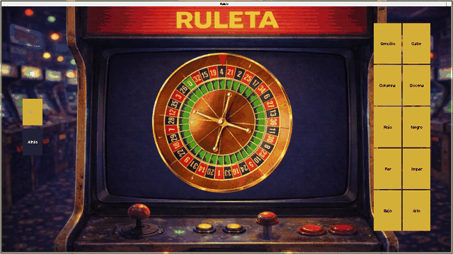
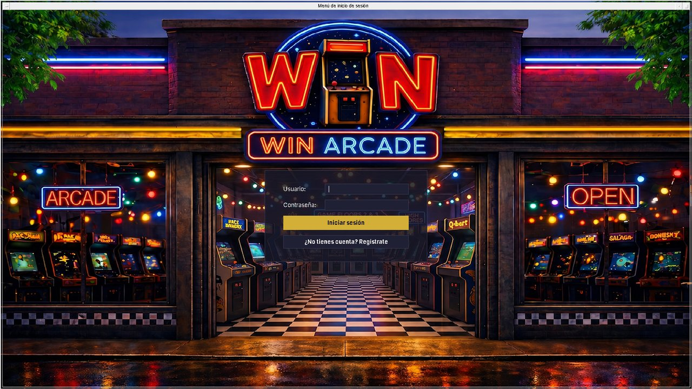
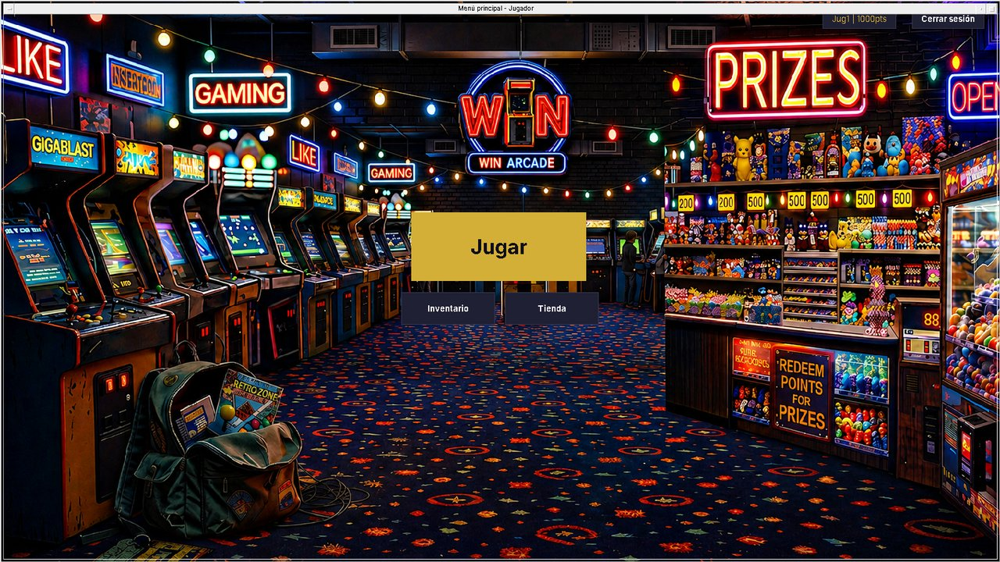
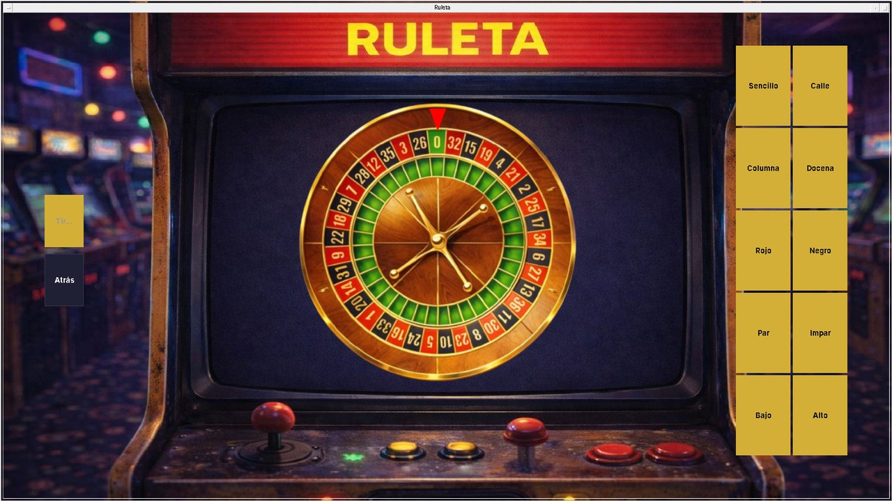
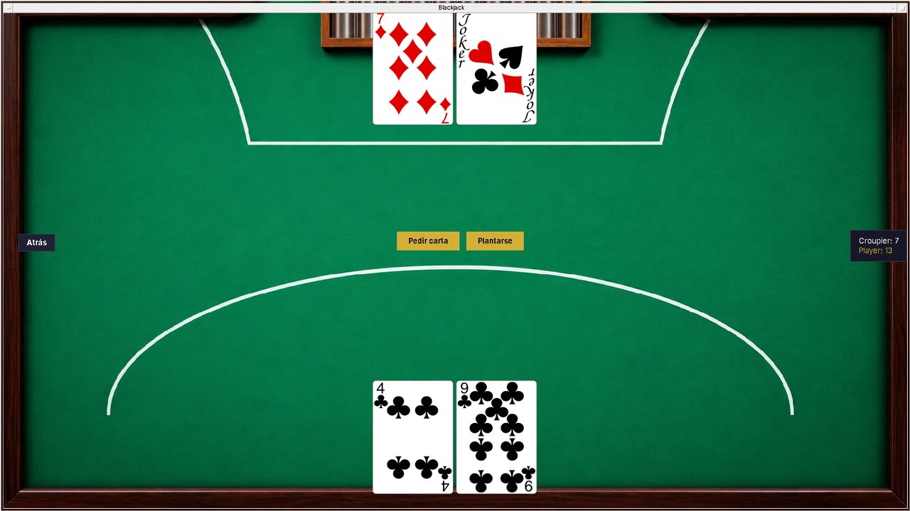
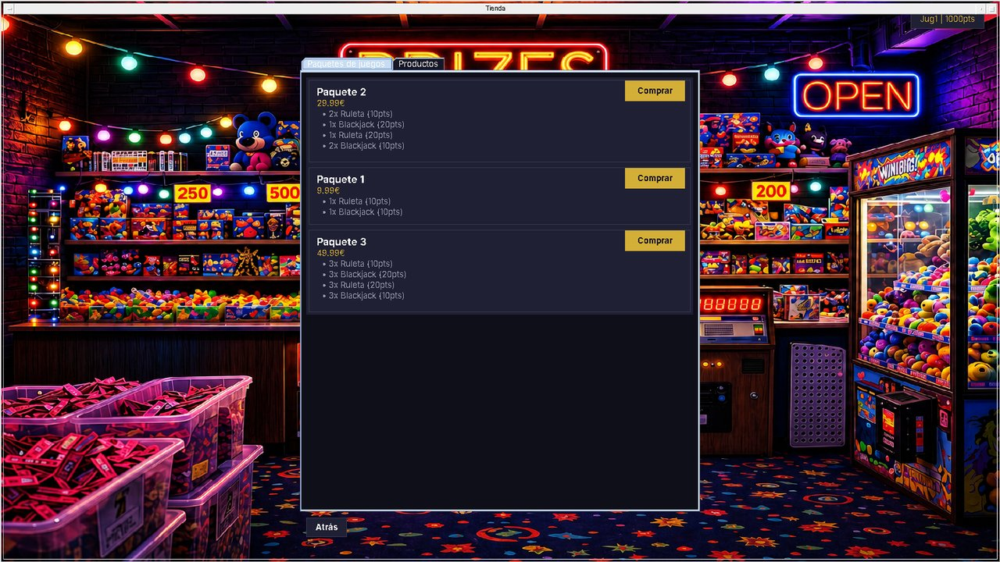
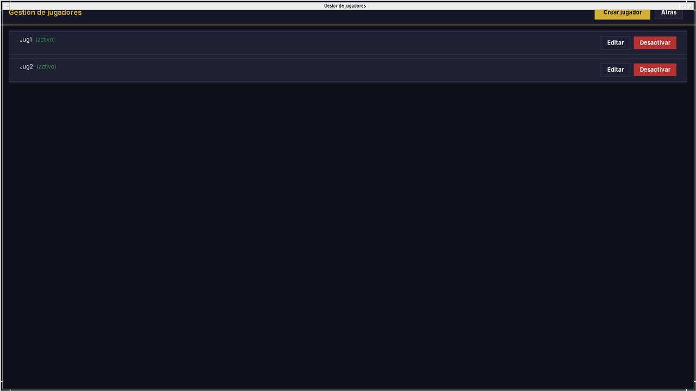
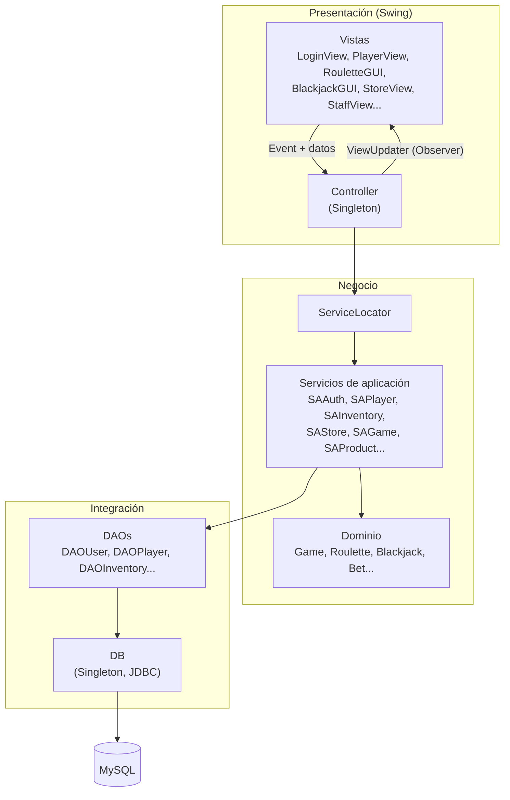
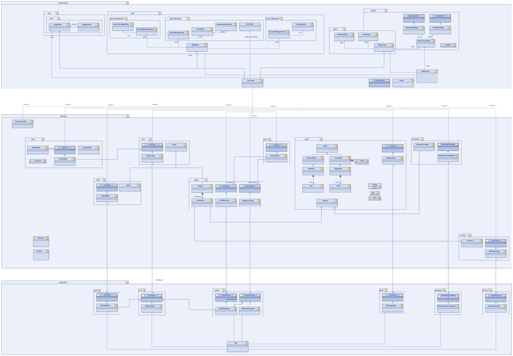
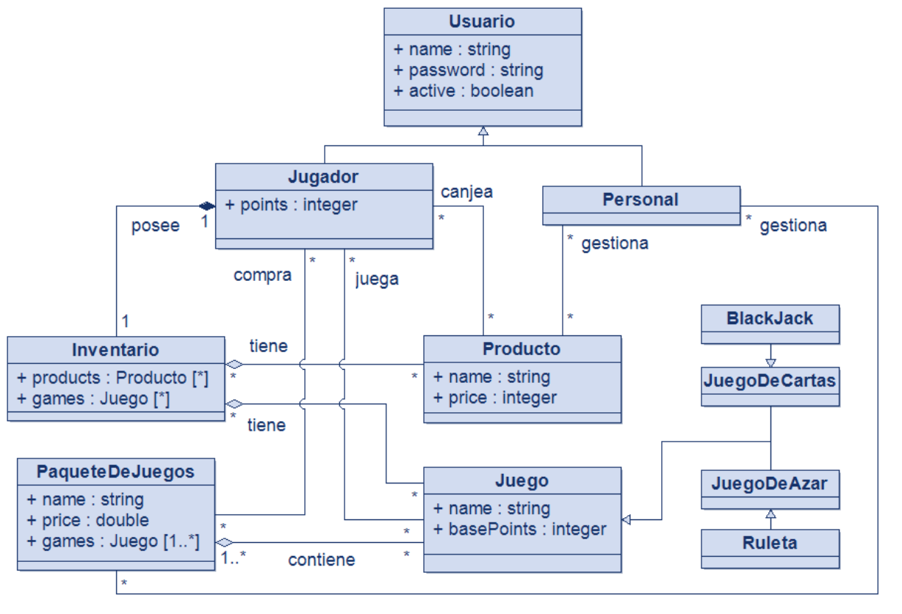

<div align="center">

# WIN Arcade

**Recreativa de escritorio con juegos de casino en la que se juega por puntos, no por dinero, y los puntos se canjean por premios.**

[](https://github.com/xilin01/IS2-WIN-Arcade/actions/workflows/tests.yml)
[](LICENSE)




---

## Sobre el proyecto

WIN es una recreativa de escritorio en Java. Los jugadores compran paquetes de partidas, juegan a la **ruleta** y al **blackjack**, ganan puntos y los canjean en la **tienda** por productos (camisetas, tazas, pines...). Al quitar el dinero como premio, el modelo de apuesta se convierte en un sistema de fidelización y ocio responsable.

Además, incluye un **panel de personal** para gestionar paquetes de juegos, productos y jugadores.

Proyecto final de **Ingeniería del Software II**, desarrollado por un equipo de 6 personas con un proceso **RUP adaptado** en tres iteraciones de construcción: modelado UML completo primero, código después.

---

## Capturas

|            Inicio de sesión            |                  Menú del jugador                  |
| :--------------------------------------: | :-------------------------------------------------: |
|  |      |
|             **Ruleta**             |                 **Blackjack**                 |
|            |                |
|             **Tienda**             |            **Panel del personal**            |
|            |  |

---

## Funcionalidades

**Jugador**

- Registro e inicio de sesión.
- Ruleta animada con 10 tipos de apuesta: número, calle, columna, docena, rojo/ negro, par/ impar, bajo/ alto.
- Blackjack contra el croupier (pedir carta/ plantarse).
- Inventario de partidas y productos.
- Tienda: compra de paquetes de juegos y canje de puntos por productos.

**Personal**

- CRUD de paquetes de juegos, productos y jugadores.
- Edición del inventario de cada jugador y activación/ desactivación de cuentas.

**Reglas de negocio**

- Nombres de usuario únicos.
- Los puntos nunca pueden quedar en negativo: el sistema bloquea cualquier canje que lo provoque.
- Los canjes son definitivos.

---

## Arquitectura

Arquitectura **multicapa** (presentación, negocio e integración) con **MVC** en la capa de presentación. Ninguna capa importa implementaciones de otra: todo pasa por interfaces y un **Service Locator**.



```
app/
├── src/
│   ├── presentation/   Vistas Swing, Controller, Theme (fachada de estilos), GUIFactory
│   ├── business/       Servicios de aplicación (SA*), transfers (t*) y dominio de juegos
│   ├── integration/    DAOs y conexión JDBC
│   └── mainLauncher/   Punto de entrada: registra los servicios y abre el login
├── test/               107 tests: unitarios (Mockito), integración y sistema
├── resources/          Cartas e imágenes de la interfaz
└── lib/                Dependencias (.jar)
db/create-script.sql    Esquema y datos de ejemplo
modelio/                Modelos UML (Modelio)
documentation/          Memoria del proyecto y diagrama de Gantt
```

### Patrones de diseño aplicados

Cada patrón se introdujo para resolver un problema concreto, no por usarlo.

| Patrón                   | Dónde                                    | Qué resuelve                                                                                                                                                     |
| ------------------------- | ----------------------------------------- | ----------------------------------------------------------------------------------------------------------------------------------------------------------------- |
| **Strategy**        | `Roulette.Bet`                          | Cada apuesta encapsula su condición de victoria como un `Predicate<Integer>`. Sustituye un condicional gigante, añadir una apuesta no toca código existente. |
| **Template Method** | `Game` → `ChanceGame` / `CardGame` | Contrato común `play()`: la ruleta genera el número y el blackjack reparte cartas.                                                                           |
| **Observer**        | `Controller` + `ViewUpdater`          | El controlador notifica resultados sin conocer las vistas concretas.                                                                                              |
| **Facade**          | `Theme`                                 | Las vistas usan una única interfaz para colores, tipografía y componentes Swing.                                                                                |
| **Singleton**       | `Controller`, `Theme`, `DB`         | Una sola sesión, un solo tema, una conexión JDBC reutilizada.                                                                                                   |
| **Factory Method**  | `AuthResult`, apuestas                  | Construcción de resultados y apuestas válidas sin exponer su estructura.                                                                                        |
| **Service Locator** | `ServiceLocator`                        | Desacopla presentación y negocio: el controlador pide interfaces, nunca implementaciones.                                                                        |
| **DAO**             | `integration/*`                         | Aísla la persistencia de la lógica de negocio.                                                                                                                  |

El diseño sigue los principios **SOLID** (por ejemplo, `SAStoreImp` recibe por constructor las interfaces de los servicios de los que depende) y **GRASP** (Controlador, Experto, bajo acoplamiento, alta cohesión).

<details>
<summary><b>Diagrama de clases completo</b></summary>



</details>

<details>
<summary><b>Modelo de dominio</b></summary>



</details>

---

## Pruebas

Estrategia piramidal con **107 tests** (JUnit + Mockito):

- **Unitarios:** juegos (`RouletteTest`, `BlackjackTest`) y servicios con dependencias simuladas mediante mocks y stubs.
- **Integración:** servicios y DAOs contra una base de datos MySQL real.
- **Sistema y negativos:** flujos completos a través del `Controller`, incluidos casos de entrada inválida.

Los tests se ejecutan automáticamente en cada push con GitHub Actions (ver `.github/workflows/tests.yml`).

---

## Cómo ejecutarlo

**Requisitos:** Java 21 y MySQL 8 (o MariaDB). Las dependencias ya están en `app/lib/`.

**1. Base de datos**

```bash
mysql -u root -p -e "CREATE DATABASE e4win;"
mysql -u root -p e4win < db/create-script.sql
```

La conexión está configurada en `app/src/integration/DB.java` (`root` / `equipo4` en `localhost`). Cambia esos valores si tu MySQL usa otras credenciales.

**2. Compilar y lanzar** (desde `app/`)

```bash
javac -encoding UTF-8 -d out -cp "lib/*" $(find src test resources -name "*.java" ! -name module-info.java)
cp -r resources/cards resources/images out/
java -cp "out:lib/*" mainLauncher.Main
```

En Windows usa `;` en lugar de `:` en el classpath (`"out;lib/*"`).

También puedes importar `app/` como proyecto existente en **Eclipse** y ejecutar `mainLauncher.Main`.

**3. Tests**

```bash
java -jar lib/junit-platform-console-standalone-6.0.3.jar execute --scan-class-path \
  --class-path "out:lib/mockito-core-5.23.0.jar:lib/byte-buddy-1.18.8.jar:lib/byte-buddy-agent-1.18.8.jar:lib/objenesis-3.5.jar:lib/mysql-connector-j-9.6.0.jar"
```

**Usuarios de prueba** (creados por el script SQL):

| Usuario   | Contraseña | Rol                                                 |
| --------- | ----------- | --------------------------------------------------- |
| `Jug1`  | `jug1`    | Jugador con 1000 puntos y partidas en el inventario |
| `Xiang` | `xiang`   | Personal                                            |

---

## Contribución

Proyecto en equipo, mi contribución:

- **Juegos:** implementación de `Roulette` y `Blackjack`, y del patrón **Strategy** en las apuestas de la ruleta.
- **Interfaz:** `GamesPanelView`, `StoreView`, `InventoryView` y `PlayerView`.
- **Negocio y persistencia:** CRUDs de usuarios y personal, `SAPlayer`, `SAInventory`, Singleton de `DB` y script SQL.
- **Calidad:** tests del `Controller` y revisiones de código detalladas.
- **Documentación:** redacción y estructura de la memoria, todos los casos de uso y todos los diagramas de actividad.

---

## Equipo

Diego González del Castillo Ramírez de Arellano · Mario González García · **Xiang Lin** · Luis Yael Masongsong Peña · Adrián Prieto Fernández · Mario Rosell García

La documentación completa (requisitos, casos de uso, diagramas de secuencia, pruebas y conclusiones) está en [`documentation/MEMORIA.docx`](documentation/MEMORIA.docx).

---

## Licencia

Distribuido bajo la licencia **MIT**. 

Consulta el archivo [`LICENSE`](LICENSE) para más detalles.
